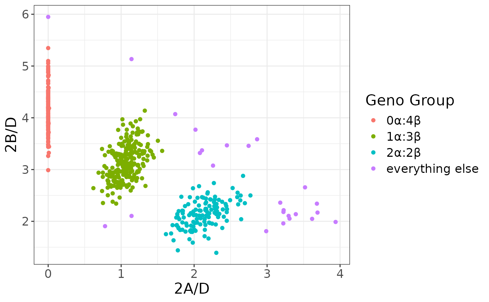

# Estimating Tryptase Copy Numbers from Sequence Data

## Overview

We have developed a likelihood-based approach for estimating tryptase
copy numbers (specifically the numbers of $`\alpha`$ alleles, $`\beta`$
alleles and $`\beta`$ frameshift alleles) directly from whole-genome
(preferable) or whole-exome sequence data. The approach utilizes an
updated assembly of canonical $`\alpha`$, $`\beta`$, and $`\delta`$
tryptase alleles, and identifies reads that map uniquely to only one of
these alleles. The complete workflow is implemented in the package
TrypLik.

## Background

The tryptase gene cluster contains four closely spaced paralogous genes
on chromosome 16p13.3. These include TPSAB1 and TPSB2, which together
encode the $`\alpha`$ and $`\beta`$ tryptase peptides. TPSAB1 encodes
two major alleles, $`\alpha`$ and $`\beta`$I, while TPSB2’s major
alleles are $`\beta`$II and $`\beta`$III. $`\alpha`$ and $`\beta`$I are
$`\sim1\%`$ diverged over a $`1.2`$ Kbp region, while $`\beta`$I and
$`\beta`$II differ by just a single nucleotide over the same region.
$`\alpha`$ alleles are thought to be enzymatically inactive, and while
most $`\beta`$ alleles are active, there is a specific $`\beta`$
frameshift variant ($`\beta`$III$`^{FS}`$) that is inactive.

Recent work has identified a familial inherited syndrome, hereditary
alpha tryptasemia (H$`\alpha`$T), which is associated with one or more
duplications of the $`\alpha`$ allele in TPSAB1 Lyons et al., 2016.
Common phenotypes found in H$`\alpha`$T patients include systemic venom
reactions, pruritis, IBS, reflux, skeletal abnormalities, retained
primary dentition and anthralgia. There is also evidence for $`\beta`$
duplications and deletions (Chollet et al., 2021, Glover et al., 2022),
though it is not yet clear if this reflects copy number variants (CNVs)
in only TPSAB1 or CNVs in both TPSAB1 and TPSAB2. Nothing is known about
the clinical effects of tryptase $`\beta`$ copy number variation.

While $`\alpha`$, $`\beta`$, and $`\beta`$III$`^{FS}`$ copy numbers can
be accurately determined using custom droplet digital PCR (ddPCR) assays
(cf. Lyons et al., 2016), it is much more challenging to estimate copy
numbers from standard short-read (e.g. Illumina) sequence data, even
with a high depth of coverage. This is primarily due to the fact that
$`\alpha`$, $`\beta`$, and $`\beta`$III$`^{FS}`$ tryptase alleles are so
similar, but exacerbated by errors in the human reference genome
assembly (hg38), which appears to have chimeric alleles for both TPSAB1
and TPSB2. In addition, the published allelic sequences in Maun et al.,
2019 also appear to be incorrect. This has motivated our efforts to
generate our own consensus assemblies of different tryptase alleles (see
below).

## Instructions on use

There are two main parts to the workflow: First, we map reads to a
tryptase consensus sequence and count the ones that map uniquely to
tryptase $`\alpha`$, $`\beta`$, $`\beta`$III$`^{FS}`$ and $`\delta`$
alleles. Second, we perform Bayesian likelihood calculations to estimate
the most likely copy number count. We describe each step in greater
detail below.

### Tryptase read mapping

This part of the workflow can be broken up into the following
components:

1.  Subset an indexed bam file to consider only reads mapping to the
    tryptase region
2.  Convert the output back to (the original) paired-end fastq reads
3.  Map raw reads to consensus tryptase sequence
4.  Remove duplicates
5.  Count the numbers of reads containing specific 30 bp motifs that map
    specifically to a single tryptase allele

There are different ways to go about each of these steps:

#### Indexing bam files

If a datafile is not already indexed, we recommend using samtools to do
so. For example, we use publicly available high-coverage whole genome
sequence data from the 1000 Genomes Project as a test case. We
downloaded the file “HG00100.final.cram” from
<https://www.internationalgenome.org/data-portal/sample/HG00100> to use
as an example.Indexing and subsetting can be performed with the
following commands:

``` bash
samtools index HG00100.final.cram
samtools view -b -h HG00100.final.cram chr16:1200000-1300000 > HG00100.tryptase.cram
samtools index HG00100.tryptase.cram
```

#### Converting indexed cram files to fastq reads

One possibility for doing this uses samtools again:

``` bash
samtools sort -n HG00100.tryptase.cram -o HG00100.tryptase.sorted.cram
samtools fastq -1 HG00100.tryptase.R1.fastq -2 HG00100.tryptase.R2.fastq -0 /dev/null -s /dev/null -n HG00100.tryptase.sorted.cram
```

#### Mapping reads to tryptase consensus sequence

Here, we are using the tryptase consensus sequence published by Maun et
al., 2019 to winnow out reads that are in the tryptase region that do
not actually map to tryptase genes. The following command works for our
continuing example:

``` bash
bwa mem consensus.fa HG00100.tryptase.R1.fastq HG00100.tryptase.R2.fastq > out.sam
```

The file `consensus.fa` is included with this package in
[inst/consensus.fa](https://hibio.github.io/TrypLik/articles/inst/consensus.fa).

#### Removing duplicates

This is generally done using Picard or samtools. Here is an example of
doing so using samtools, with the output written to the file “temp.sam”.

``` bash
samtools sort -n out.sam -o out.sorted.sam
samtools fixmate -m out.sorted.sam fixmate.sam
samtools sort -o positionsort.sam fixmate.sam
samtools markdup -r positionsort.sam temp.sam
```

#### Counting reads mapping to specific tryptase alleles

The file “count_tryptase.sh” is a shell script that counts the numbers
of reads that map specifically to different tryptase alleles (see below
for technical details). It requires the input file to be called
“temp.sam”. Output consists of $`9`$ integers summarizing read counts:

- The first four of these are the numbers of reads mapping uniquely to
  $`\alpha`$, $`\beta`$I, $`\beta`$II or $`\beta`$III alleles in the
  specific $`83`$ bp region where all four alleles can be distinguished
  from each other.

- The next two are the numbers of reads that map uniquely to $`\beta`$
  ‘wildtype’ (i.e. not frameshifted) and $`\beta`$ frameshifted
  sequences

- The final three are the numbers of reads that can be uniquely mapped
  to $`\alpha`$, $`\beta`$, or $`\delta`$ alleles respectively

Further details on these can be found in the technical details below.
For our example with sample HG00100 from the 1000 Genomes Project, the
output of “count_tryptase” is

``` bash
24    0   22    0   26    0   347   316   304
```

The above processing can be performed in R (provided samtools and bwa
are available) with the following wrappers

``` r

sam_file <- preprocess("HG00100.final.cram")
counts <- count_tryptase(sam_file)
```

``` r

counts
#> [1]  24   0  22   0  26   0 347 316 304
```

### Tryptase copy number likelihood calculations

The last five numbers from the output of “count_tryptase” are used as
input to the program TrypLik to estimate the likelihoods of different
combinations of total number of $`\alpha`$ alleles, total number of
$`\beta`$ alleles, and total number of $`\beta`$ frameshift alleles. The
method accounts for dependence across read counts (caused by the same
$`2 \times 150`$ bp read generally overlapping multiple of the regions
used to distinguish between alleles) and also uses prior information on
CNV frequencies in different populations. Usage is

``` bash
TrypLik WT FS Areads Breads Dreads (-pop POP)
```

`WT`: number of reads mapping to $`\beta`$ “wildtype” alleles at the
site of the frameshift mutation (5th field from “count_tryptase” output)

`FS`: number of reads mapping to $`\beta`$ frameshift alleles at the
site of the frameshift mutation (6th field from “count_tryptase” output)

`Areads`: number of reads mapping uniquely to $`\alpha`$ alleles
relative to $`\beta`$ and $`\delta`$ alleles (7th field from
“count_tryptase” output)

`Breads`: number of reads mapping uniquely to $`\beta`$ alleles relative
to $`\alpha`$ and $`\delta`$ alleles (8th field from “count_tryptase”
output)

`Dreads`: number of reads mapping uniquely to $`\delta`$ alleles
relative to $`\alpha`$ and $`\beta`$ alleles (9th field from
“count_tryptase” output)

`-pop POP`: optional flag to specify the predominant ancestry of the
test sample. Options include EUR for European ancestry, SAS for South
Asian ancestry, EAS for East Asian ancestry and AFR for African
ancestry. The default, if the `-pop` flag is not included, is European
ancestry.

Note that these likelihood calculations assume that all individuals
contain exactly two tryptase $`\delta`$ alleles. `Dreads` acts as a
‘control’ from which we estimate the other copy numbers. The output
consists of a list of different $`\alpha`$, $`\beta`$ and $`\beta`$
frameshift allele copy numbers followed by the combination’s posterior
probability. To continue our example from before, calculation for
HG00100 would use the command

``` bash
TrypLik 26 0 347 316 304 -pop EUR
```

Output would look like this:

| Alpha count | Beta count | Beta FS count | Posterior likelihood |
|:------------|:-----------|:--------------|:---------------------|
| 2           | 2          | 0             | 0.99890              |
| 2           | 3          | 0             | 0.00008              |
| 3           | 2          | 0             | 0.00082              |
| 3           | 3          | 0             | 0.00020              |

The method estimates that HG00100 has a 2$`\alpha:2\beta:2\delta`$
genotype (with no frameshift alleles) with posterior probability 99.89%.

An R wrapper for this function is provided, which takes either a single
vector of values or individual arguments

``` r

TrypLik(counts)
#>   Alpha_count Beta_count Beta_FS_count Posterior_likelihood
#> 1           2          2             0              0.99890
#> 2           2          3             0              0.00008
#> 3           3          2             0              0.00082
#> 4           3          3             0              0.00020

# or TrypLik(26, 0, 347, 316, 304, pop = 0)
```

## Technical details

### de novo assembly/alignment

We started by aligning cDNA sequences to a 40 bp region near the probes
used by Lyons et al., 2016(Supplementary Figure 3b) for ddPCR.

|                     |                                             |
|---------------------|:--------------------------------------------|
| Delta (CCDS10432.1) | CCAGGCCAGG CCCTGCAGCA AACGGGCATT GTTGGGGGGC |
| Alpha (M30038.1)    | CCAGTCCAGG CCCTGCAGCA AGCGGGTATC GTCGGGGGTC |
| Beta1 (M33492.1)    | CCAGGCCAGG CCCTGCAGCG AGTGGGCATC GTCGGGGGTC |
| Beta2 (BC065923.1)  | CCAGGCCAGG CCCTGCAGCG AGTGGGCATC GTTGGGGGTC |
| Beta3 (AF099143)    | CCAGGCCAGG CCCTGCAGCG AGTGGGCATC GTTGGGGGTC |

Here sites in red are fixed differences between TPSD1 and
(TPSAB1+TPSB2), while sites in yellow can be used to distinguish
$`\alpha`$, $`\beta`$I, and $`\beta`$II/$`\beta`$III alleles from each
other. $`\beta`$II and $`\beta`$III alleles are distinguishable from
each other at sites near the Lyons et al., 2016 REV primer as follows:

|                    |                       |
|--------------------|:----------------------|
| Beta2 (BC065923.1) | GAGAGTCCAC GGCCCATACT |
| Beta3 (AF099143)   | GAGAGTCCGC GACCGATACT |

We assumed that the sequences listed above are correct and invariant in
the different tryptase alleles. We then used Illumina short read data to
‘extend’ allele-specific alignments. Specifically, we combined the raw
reads from 30 randomly chosen individuals of European ancestry from the
1000 Genomes Project (high-coverage data generated by the NYGC) and
pulled out those reads that matched the above sequences. We then could
expand on the allele-specific assemblies by looking at the alignments
just 5’ and 3’ to the sequences shown above, and concurrently identify
common allele-specific polymorphisms. We continued to iteratively extend
these assemblies until $`\alpha`$ and $`\beta`$ alleles could not be
distinguished from each other. Roughly speaking, since the Illumina data
consisted of 150 bp reads, this process can continue as long as there is
a fixed difference between allelic assemblies every $`\sim 150`$ bp. We
extended these assemblies across $`\sim 1.1`$ Kbp of sequence including
most of the coding regions (see Appendix 1).

Our alignments show the expected difference between $`\alpha`$ and
$`\beta`$ alleles at the putative functional mutation. In addition, we
confirm that the frameshift mutation happens only on a $`\beta`$III
background (leading to the inactivated $`\beta`$III$`^{FS}`$ allele),
and that the $`\beta`$I and $`\beta`$II consensus sequences differ by
just a single nucleotide, despite $`\beta`$I being an allele that is
(supposed to be) exclusive to TPSAB1 and $`\beta`$II being confined to
TPSB2. This likely reflects paralogous gene conversion between tryptase
genes over evolutionarily recent time scales.

The tryptase allele assemblies generated here differ slightly from all
previously published assemblies, including some of the cDNA sequences,
the Lyons et al., 2016 tryptase alignment, the Maun et al., 2019
tryptase alignment, and the human reference genome (hg38). We believe
though that Illumina reads are highly accurate, and can show how these
previous assemblies are inconsistent with Illumina data from multiple
individuals.

## Tryptase CNV genotyping from high-coverage Illumina reads

From the alignment described above, we identified $`11`$ different
$`30`$ bp regions where reads could be uniquely mapped to $`\alpha`$,
$`\beta`$, or $`\delta`$ alleles. Using the base numbering defined by
Maun et al., 2019(Data S1) and also used in the accompanying table,
these correspond to the following regions:

``` math
\begin{array}{ccc}
560\, – 589 & 1010\, – 1039 & 1360\, – 1389 \\
740\, – 769 & 1115 \sim 1146 & 1510\, – 1539 \\
840\, – 869 & 1220\, – 1249 & 1560\, – 1589 \\
940\, – 969 & 1260\, – 1289 
\end{array}
```

Tallying up the total number of ‘$`\alpha`$ reads’, ‘$`\beta`$ reads’
and ‘$`\delta`$ reads’ (which we call here $`A`$, $`B`$ and $`D`$
respectively) gives us a way of estimating the relative copy numbers of
$`\alpha`$, $`\beta`$ and $`\delta`$ alleles. In particular, if we
assume each individual has exactly two copies of TPSD1 (i.e. no copy
number variation in TPSD1), then the number of $`\alpha`$ and $`\beta`$
alleles can be estimated by $`2A/D`$ and $`2B/D`$ respectively.

Some caveats apply:

1.  The regions are not independent of each other, since the
    $`2 \times 150`$ bp paired-end reads generally include multiple
    regions. This leads to a greater variance than otherwise expected in
    estimated allele counts.

2.  Even in a pool of individuals with the same true number of
    $`\alpha`$ and $`\beta`$ alleles, the estimates $`2A/D`$ and
    $`2B/D`$ will be correlated since they both have the same
    denominator.

3.  Unknown (or unaccounted for) polymorphisms within an allelic class
    can lead to misclassified reads. This is perhaps most important in
    the analysis of non-European ancestry individuals.

4.  The method assumes that all CNVs affect the entire $`1`$ Kbp test
    region, though we know this isn’t true. Chovanec, 2022 report the
    existence of σ alleles, which appear to be a chimera of $`\alpha`$
    and $`\beta`$ alleles. In our analyses, these alleles are estimated
    as partial $`\alpha`$ and partial $`\beta`$, proportional to the
    numbers of reads mapping to each canonical allele assembly.

We suggest using an empirically-based approach for estimating the bias
in the estimates (e.g. estimating

``` math
E \bigl( \frac{2A}{D} |\ \textrm{actual number of }\alpha\textrm{ alleles is known} \bigr)
```

that uses orthogonal information on true allele counts (e.g. validated
ddPCR data). A preliminary version of this is described below.

## $`\beta`$III frameshift mutation

The approach described above can estimate the total copy number of
tryptase beta alleles, but some of these beta alleles are inactive due
to a frameshift mutation. In parallel, we conduct a read-counting
exercise that counts reads that uniquely map to the
$`\beta`$III$`^{FS}`$ allele and reads that map to all other $`\beta`$
alleles:

|                       |                                   |
|-----------------------|:----------------------------------|
| $`\beta`$III$`^{FS}`$ | CTCAGAGACC TTCCCCCCCG GGGATGCCGT  |
| All other $`\beta`$   | CTCAGAGACC TTCCCCCC–G GGGATGCCGTG |

(Note that both $`\alpha`$ and $`\sigma`$ alleles do not map to either
of these sequences.) The observed numbers of reads in each of these two
categories (called here FS+ and FS-) is expected to follow a binomial
distribution with probabilities proportional to the true numbers of
$`\beta`$III$`^{FS}`$ and non-$`\beta`$III$`^{FS}`$$`\beta`$ alleles.
Further, by assumption, $`\beta`$III$`^{FS}`$ alleles only occur in
TPSB2. If data = {FS+, FS-}, then under a simple likelihood framework,

\$\$ \rm{lik} \bigl(data\bigr) \sim Pr \bigl(genotype\bigr)\\ Pr \bigl(
data\\ \|\\ genotype\bigr) \$\$

Suppose for example we observe $`28`$ and $`36`$ reads supporting
$`\beta`$III$`^{FS}`$ and non-$`\beta`$III$`^{FS}`$$`\beta`$ alleles
respectively (i.e. data = $`\{28, 36\}`$) in an individual of European
ancestry with an estimated tryptase CNV genotype of
$`0\alpha:4\beta:2\delta`$. Based on the European $`1`$ KGP data, the
frequency of the $`\beta`$III$`^{FS}`$ mutation is $`\sim\!0.1766`$. So,
the naïve (i.e. prior or Hardy-Weinberg) probability of a homozygous
$`\beta`$III$`^{FS}`$ genotype (i.e. $`\beta`$III$`^{FS}`$ mutations on
both chromosomes) is $`(0.1766)^2`$ and the probability of having
exactly one copy of $`\beta`$III$`^{FS}`$ is $`2(0.1766)(1-0.1766)`$.
Assuming the estimated tryptase CNV genotype is correct, we calculate

``` math
 \textrm{Pr} \bigl(\textrm{data}\ |\ \beta\textrm{III}^{FS}\, \textrm{heterozygote}\bigr) = {64 \choose 28} (0.25)^{28}(0.75)^{36},\ \textrm{and}
```
``` math
 \textrm{Pr} \bigl(\textrm{data}\ |\ \beta\textrm{III}^{FS}\, \textrm{homozygote}\bigr) = {64 \choose 28} (0.5)^{28} (0.5)^{36}
```

and

``` math
 \textrm{lik} \bigl(\beta\textrm{III}^{FS}\, \textrm{homozygote}\bigr) \sim 0.0018922,\ \textrm{and}
```
``` math
 \textrm{lik} \bigl(\beta\textrm{III}^{FS}\, \textrm{heterozygote}\bigr) \sim 0.00014354
```

In a Bayesian context, the posterior
$`\textrm{Pr} \bigl(\beta\textrm{III}^{FS}\, \textrm{homozygote}\bigr) = 0.9295`$,
and we conclude that the individual is likely to have $`0 \alpha`$
alleles, $`2`$ active $`\beta`$ alleles and $`2`$ inactive
$`\beta`$III$`^{FS}`$ alleles.

## Tryptase CNV genotyping revisited: likelihood framework

In an idealized world where the 4 caveats described above do not apply,
each read would be independent and the read counts $`(A, B, D)`$ could
be modeled as following a multinomial distribution conditional on the
sum $`A+B+D`$, with probabilities for each category proportional to the
true copy numbers of $`\alpha`$$`\beta`$ and $`\delta`$. We employ two
modifications to this model to account for deviations from model
assumptions:

1.  We replace $`(A+B+D)`$ by $`(A+B+D) / R`$, the “effective number of
    independent read counts”, to account for caveat \#1

2.  We reweight the multinomial probabilities by factors of
    $`E(2A/D\ |\ \alpha\ \textrm{copy number} = 1)`$ and
    $`E(2B/D\ |\ \beta\ \textrm{copy number} = 3)\ /\ 3`$ for $`\alpha`$
    and $`\beta`$ copy numbers to account for unknown structural
    variants and/or polymorphisms

We use empirical data from the EUR populations from the 1000 Genomes
Project to estimate these correction factors. First, we plotted $`2A/D`$
vs. $`2B/D`$ for these $`503`$ samples:

``` r

genomes <- TrypLik::tryptase_1KG()

library(ggplot2)

ggplot(genomes, aes(`2A/D`, `2B/D`, col = `Geno Group`)) +
    geom_point() +
    theme_bw() +
    theme(text = element_text(size = 16))
```



The source for this data is available to an R session with
[`tryptase_1KG()`](https://hibio.github.io/TrypLik/reference/tryptase_1KG.md)

``` r

head(tryptase_1KG())
#>   2A/D   2B/D Geno Group
#> 1    0 2.9885      0α:4β
#> 2    0 3.2629      0α:4β
#> 3    0 3.4384      0α:4β
#> 4    0 3.4791      0α:4β
#> 5    0 3.4792      0α:4β
#> 6    0 3.5294      0α:4β
tail(tryptase_1KG())
#>       2A/D   2B/D      Geno Group
#> 498 3.3934 2.1381 everything else
#> 499 3.5198 2.6565 everything else
#> 500 3.6170 2.0479 everything else
#> 501 3.6826 2.3413 everything else
#> 502 3.6910 2.1691 everything else
#> 503 3.9388 1.9878 everything else
```

We focus on the dots colored green, which are estimated to have a
tryptase genotype of $`1\alpha:3\beta:2\delta`$. The average values of
$`2A/D`$ and $`2B/D`$ are $`1.06`$ and $`3.13`$ respectively, and these
means are relatively insensitive to the inclusion/exclusion of specific
points on the periphery of the central mass. In addition, we note that

``` math
\begin{eqnarray}
 \textrm{Var}(2A/D) &=& 0.0263 \\
 \textrm{Var}(2B/D) &=& 0.1286 \\
 r^2 (2A/D, 2B/D) &=& 0.1953 \\
\end{eqnarray}
```

We then ran simulations with different values of R (but conditional on
the observed $`A`$, $`B`$ and $`D`$ values) to heuristically find a
value that, on average, produces correlation and variances similar to
what was observed. We settled on $`R = 2.75`$, but with the caveat that
this estimation process was entirely qualitative. We do note though that
this $`R`$ is approximately equal to the number of $`30`$ bp informative
regions covered by an average $`2\times 150`$ bp read pair in the target
tryptase region. As an example of the process, suppose the observed data
$`\{A, B, D\} = \{192, 600, 290\}`$ and that we want to estimate the
probability of observing the data given a true genotype of
$`1\alpha:4\beta`$. Then, $`2A/D = 1.324, 2B/D = 4.138`$, and the
‘effective number of independent reads is
$`(192+600+290)/2.75 \approx 393`$. Then, to estimate the probability of
the genotype $`1\alpha:3\beta:2\delta`$, for example, we calculate

``` math
\begin{align}
&\textrm{Pr}\left(2A/D \approx 1.324\ \&\&\ 2B/D \approx 4.138\ |\ \textrm{true genotype is } 1\alpha:3\beta:2\delta\right) \approx \\
&\textrm{Pr}\left(2A/D \approx 1.324\ \&\&\ 2B/D \approx 4.138\ |\ 393 \textrm{ independent reads are simulated from a}\right. \\
&\textrm{multinomial distribution with relative probabilities of } 1.06, 3.13 \textrm{ and } 2 \textrm{ for } \alpha, \beta, \\
&\left.\textrm{ and } \delta \textrm{ reads respectively}\right)
\end{align}
```
These are actually approximate likelihoods; operationally,
$`2A/D \approx 1.324`$ is the estimated probability that the simulated
$`2A/D`$ is between $`(0.99\times1.324)`$ and $`(1.01\times1.324)`$. To
calculate posterior probabilities, we still need a prior estimate of the
population-level genotype frequencies. There is some element of
circularity here since we ultimately are estimating genotypes (which go
in to the population-level genotype frequency estimates). Ideally we
would have an independent way of assessing population frequencies
(e.g. widespread ddPCR), but in the absence of that we have obtained
crude prior estimates (see Table 1 below) by qualitative assessments of
figures like Figure 1. Continuing with our example (and assuming
European ancestry), we estimate

``` math
\begin{align}
  \textrm{lik}\left(1\alpha:3\beta:2\delta\right) &\sim \textrm{Pr}\left(1\alpha:3\beta:2\delta\right)\ \times \\
  &\; \; \; \; \; \textrm{Pr}\left(2A/D \approx 1.324\ \&\&\ 2B/D \approx 4.138\ | \right. \\ 
  &\; \; \; \; \; \; \; \; \; \; \; \left.\textrm{genotype} = 1\alpha:3\beta:2\delta\right) \\
  &= 0.434 \times 0.0002521 \\
  \\
  \textrm{lik}\left(1\alpha:4\beta:2\delta\right) &\sim \textrm{Pr}\left(1\alpha:4\beta:2\delta\right)\ \times \\ 
  &\; \; \; \; \; \textrm{Pr}\left(2A/D \approx 1.324\ \&\&\ 2B/D \approx 4.138\ | \right. \\ 
  &\; \; \; \; \; \; \; \; \; \; \; \left. \textrm{genotype} = 1\alpha:4\beta:2\delta\right) \\
  &= 0.03 \times 0.0012967 \\
  \\
  \textrm{lik}\left(1\alpha:5\beta:2\delta\right) &\sim \textrm{Pr}\left(1\alpha:5\beta:2\delta\right)\ \times \\
  &\; \; \; \; \; \textrm{Pr}\left(2A/D \approx 1.324\ \&\&\ 2B/D \approx 4.138\ | \right. \\ 
  &\; \; \; \; \; \; \; \; \; \; \; \left. \textrm{genotype} = 1\alpha:5\beta:2\delta\right) \\
  &= 0.0004 \times 0.000019 
\end{align}
```

The posterior probability of a $`1\alpha:3\beta:2\delta`$ genotype is
estimated at

``` math
\frac{0.434 \times 0.0002521}{0.434 \times 0.0002521 + 0.03 \times 0.0012967 + 0.0004 \times 0.000019} = 0.738
```

Note that this estimate (and many others) is highly sensitive to the
(unknown) prior population frequencies.
$`\textrm{Pr}\left(\textrm{data}\ |\ \textrm{genotype}\right)`$ is
highest for $`1\alpha:4\beta:2\delta`$ by a factor of $`5`$, but this is
swamped out by the very low prior for the allele frequency.

Table 1. Prior estimates of tryptase genotype frequencies, stratified by
ancestry: EUR = European, EAS = East Asian, AFR = African, SAS = South
Asian

| $`\alpha`$ copy number | $`\beta`$ copy number | EUR | EAS | AFR | SAS |
|:---|:---|:---|:---|:---|:---|
| 0 | 2 | 0.0001 | 0.025 | 0.001 | 0.004 |
| 0 | 3 | 0.013 | 0.037 | 0.015 | 0.053 |
| 0 | 4 | 0.219 | 0.032 | 0.274 | 0.165 |
| 0 | 5 | 0.020028 | 0.004 | 0.1 | 0.0325 |
| 0 | 6 | 0.0004 | 0.0002 | 0.008 | 0.0006 |
| 0 | 7 | 0.00005 | 0.00002 | 0.0003 | 0.00005 |
| 0 | 8 | 0.00001 | 0.000002 | 0.0001 | 0.000005 |
| 1 | 1 | 0.0001 | 0.0021 | 0.0001 | 0.0005 |
| 1 | 2 | 0.013 | 0.22 | 0.012 | 0.017 |
| 1 | 3 | 0.434 | 0.23 | 0.39 | 0.444 |
| 1 | 4 | 0.03 | 0.012 | 0.06 | 0.01 |
| 1 | 5 | 0.0004 | 0.0005 | 0.005 | 0.0005 |
| 1 | 6 | 0.00001 | 0.00001 | 0.0001 | 0.00005 |
| 1 | 7 | 0.000001 | 0.000003 | 0.00001 | 0.000005 |
| 2 | 1 | 0.001 | 0.004 | 0.0007 | 0.0003 |
| 2 | 2 | 0.208 | 0.42 | 0.126536 | 0.256129 |
| 2 | 3 | 0.03 | 0.005 | 0.003 | 0.004 |
| 2 | 4 | 0.004 | 0.0005 | 0.0001 | 0.001 |
| 2 | 5 | 0.0001 | 0.00001 | 0.00001 | 0.0001 |
| 2 | 6 | 0.00004 | 0.000002 | 0.000001 | 0.00001 |
| 3 | 1 | 0.0001 | 0.0001 | 0.0001 | 0.0001 |
| 3 | 2 | 0.018 | 0.006 | 0.003 | 0.01 |
| 3 | 3 | 0.005 | 0.001 | 0.0003 | 0.0003 |
| 3 | 4 | 0.0004 | 0.0001 | 0.0001 | 0.0001 |
| 3 | 5 | 0.00001 | 0.00001 | 0.0001 | 0.00001 |
| 4 | 2 | 0.002 | 0.0001 | 0.0001 | 0.0003 |
| 4 | 3 | 0.0008 | 0.0001 | 0.0001 | 0.0001 |
| 4 | 4 | 0.00005 | 0.0001 | 0.0001 | 0.0001 |
| 4 | 5 | 0.00001 | 0.0001 | 0.0001 | 0.0001 |
| 5 | 2 | 0.0002 | 0.00001 | 0.00001 | 0.00001 |
| 5 | 3 | 0.0001 | 0.00001 | 0.00001 | 0.00001 |
| 5 | 4 | 0.00004 | 0.00001 | 0.00001 | 0.00001 |
| 5 | 5 | 0.00001 | 0.00001 | 0.00001 | 0.00001 |
| 6 | 2 | 0.00003 | 0.000001 | 0.000001 | 0.00001 |
| 6 | 3 | 0.00001 | 0.000001 | 0.000001 | 0.000001 |
| 6 | 4 | 0.000001 | 0.000001 | 0.000001 | 0.000001 |

## Appendix

Tryptase region consensus alignments for different alleles, using the
numbering of Maun et al., 2019

Green text = cDNA sequence is potentially incorrect

Red highlight = fixed difference between delta and (alpha + beta)

Yellow highlight = polymorphic within alpha + beta, and can be used to
discriminate between alpha &/or beta alleles

Grey highlight = polymorphic within the specific allele/gene

#### Bases 370 – 449

|  |  |
|----|----|
| delta | GCCCGTCCTG GCGAGCCCGG CCTACGTGGC CCCTGGTGAG TCCCAGCCGG GGTCCACCCT GCCCCTCACC ACATTCCACA |
| alpha | GCCCGTCCTG GCGAGCCGCG CCTACGCGGC CCCTGGTGAG TCCCAGCCGG GGTCCACCCT GCCCCTCACC ACATTCCACA |
| beta | GCCCGTCCTG GCGAGCCGCG CCTACGCGGC CCCTGGTGAG TCCCAGCCGG GGTCCACCCT GCCCCTCACC ACATTCCACA |

#### Bases 450 – 549

|  |  |
|----|----|
| delta | GATCAGGGCC TGGGTGGGTT CTGGGGAGGC CGGGCTGGCC CCCACACAGG GAAGGGCTGG TCCCAGGCGT GGGGCGGCTT CTTGGTCCTG ACCTGGCACC |
| alpha | GGTCAGGGCC TGGGTGGGTT CTGGGGAGGC TGGGCTGGCC CCCACACAGG GAAGGGGTGG GCCCAGGCGT GGGGCTGCTT CCTGGTCCTG ACCTGGCACC |
| beta1 | GGTCAGGGCC TGGGTGGGTT CTGGGGAGGCCGGGCTGGCC CCCACACAGG GAAGGGCTGG GCCCAGGCGT GGGGCTGCTT CCTGGTCCTG ACCTGGCACC |
| beta2 | GGTCAGGGCC TGGGTGGGTT CTGGGGAGGCCGGGCTGGCC CCCACACAGG GAAGGGCTGG GCCCAGGCCT GGGGCTGCTT CCTGGTCCTG ACCTGGCACC |
| beta3 | GGTCAGGGCC TGGGTGGGTT CTGGGGAGGCCGGGCTGGCC CCCACACAGG GAAGGGCTGG GCCCAGGCCT GGGGCTGCTT CCTGGTCCTG ACCTGGCACC |

#### Bases 550 – 649

|  |  |
|----|----|
| delta | TGCCCCAGCC CCAGGCCAGG CCCTGCAGCA AACGGGCATT GTTGGGGGGC AGGAGGCCCC CAGGAGCAAG TGGCCCTGGC AGGTGAGCCT GAGAGTCCGC |
| alpha | TGCCCCAGCC CCAGTCCAGG CCCTGCAGCA AGCGGGTATC GTCGGGGGTC AGGAGGCCCC CAGGAGCAAG TGGCCCTGGC AGGTGAGCCT GAGAGTCCGC |
| beta1 | TGCCCCAGCC CCAGGCCAGG CCCTGCAGCG AGTGGGCATC GTCGGGGGTC AGGAGGCCCC CAGGAGCAAG TGGCCCTGGC AGGTGAGCCT GAGAGTCCAC |
| beta2 | TGCCCCAGCC CCAGGCCAGG CCCTGCAGCG AGTGGGCATC GTTGGGGGTC AGGAGGCCCC CAGGAGCAAG TGGCCCTGGC AGGTGAGCCT GAGAGTCCAC |
| beta3 | TGCCCCAGCC CCAGGCCAGG CCCTGCAGCG AGTGGGCATC GTTGGGGGTC AGGAGGCCCC CAGGAGCAAG TGGCCCTGGC AGGTGAGCCT GAGAGTCCGC |

#### Bases 650 – 749

|  |  |
|----|----|
| delta | GGCCCATACT GGATGCACTT CTGCGGGGGC TCCCTCATCC ACCCCCAGTG GGTGCTAACC GCGGCGCACT GCGTGGAACC GTGAGTCTCC TGGGGCCTGG |
| alpha | GACCGATACT GGATGCACTT CTGCGGGGGC TCCCTCATCC ACCCCCAGTG GGTGCTGACC GCGGCGCACT GCCTGGGACC GTGAGTCTCC CAGGGCCTGG |
| beta1 | GGCCCATACT GGATGCACTT CTGCGGGGGC TCCCTCATCC ACCCCCAGTG GGTGCTGACC GCAGCGCACT GCGTGGGACC GTGAGTCTCC CGGGGCCTGG |
| beta2 | GGCCCATACT GGATGCACTT CTGCGGGGGC TCCCTCATCC ACCCCCAGTG GGTGCTGACC GCAGCGCACT GCGTGGGACC GTGAGTCTCC CGGGGCCTGG |
| beta3 | GACCGATACT GGATGCACTT CTGCGGGGGC TCCCTCATCC ACCCCCAGTG GGTGCTGACC GCAGCGCACT GCGTGGGACC GTGAGTCTCC CGGGGCCTGG |

#### Bases 750 – 849

|  |  |
|----|----|
| delta | AGGGGTGGGC AAGGGCTGGA TGTGAGCCCT GGCTCCCGGG TGCTCCTGGG GGCTGCCCAG GGCCCTGAGT GGGATCCTCC GCTGCCCAGG GACATCAAGG |
| alpha | AGGGGTGGGC AAGGGCTGGA TGTGAGCCCT GGCTCCCGGG TGCTCCTGGG GGCTGCCCAG GGCCCTGAGT GGGATCCTCC GCTGCCCAGG GACGTCAAGG |
| beta1 | AGGGGTGGGG AAGGGCTGGA TGTGAGCCCT GGCTCCCGGG TGCTCCTGGG GGCTGCCCAG GGCCCTGAGT GGGATCCTCC GCTGCCCAGG GACGTCAAGG |
| beta2 | AGGGGTGGGG AAGGGCTGGA TGTGAGCCCT GGCTCCCGGG TGCTCCTGGG GGCTGCCCAG GGCCCTGAGT GGGATCCTCC GCTGCCCAGG GACGTCAAGG |
| beta3 | AGGGGTGGGG AAGGGCTGGA TGTGAGCCCT GGCTCCCGGG TGCTCCTGGG GGCTGCCCAG GGCCCTGAGT GGGATCCTCC GCTGCCCAGG GACGTCAAGG |

#### Bases 850 – 949

|  |  |
|----|----|
| delta | ATCTGGCCGC CCTCAGGGTG CAACTGCGGG AGCAGCACCT CTACTACCAG GACCAGCTGC TGCCGGTCAG CAGGATCATC GTGCACCCAC AGTTCTACAT |
| alpha | ATCTGGCCAC CCTCAGGGTG CAACTGCGGG AGCAGCACCT CTACTACCAG GACCAGCTGC TGCCGGTCAG CAGGATCATC GTGCACCCAC AGTTCTACAT |
| beta1 | ATCTGGCCGC CCTCAGGGTG CAACTGCGGG AGCAGCACCT CTACTACCAG GACCAGCTGC TGCCGGTCAG CAGGATCATC GTGCACCCAC AGTTCTACAC |
| beta2 | ATCTGGCCGC CCTCAGGGTG CAACTGCGGG AGCAGCACCT CTACTACCAG GACCAGCTGC TGCCGGTCAG CAGGATCATC GTGCACCCAC AGTTCTACAC |
| beta3 | ATCTGGCCGC CCTCAGGGTG CAACTGCGGG AGCAGCACCT CTACTACCAG GACCAGCTGC TGCCGGTCAG CAGGATCATC GTGCACCCAC AGTTCTACAC |

#### Bases 950 – 1049

|  |  |
|----|----|
| delta | CATCCAGACC GGGGCGGACA TCGCCCTGCT GGAGCTGGAG GAGCCCGTGA ACATCTCCAG CCACATCCAC ACGGTCACGC TGCCCCCTGC CTCGGAGACC |
| alpha | CATCCAGACT GGAGCGGATA TCGCCCTGCT GGAGCTGGAG GAGCCCGTGA ACATCTCCAG CCGCGTCCAC ACGGTCATGC TGCCCCCTGC CTCGGAGACC |
| beta1 | CGCCCAGATC GGAGCGGACA TCGCCCTGCT GGAGCTGGAG GAGCCGGTGA ACGTCTCCAG CCACGTCCAC ACGGTCACCC TGCCCCCTGC CTCAGAGACC |
| beta2 | CGCCCAGATC GGAGCGGACA TCGCCCTGCT GGAGCTGGAG GAGCCGGTGA AGGTCTCCAG CCACGTCCAC ACGGTCACCC TGCCCCCTGC CTCAGAGACC |
| beta3 | CGCCCAGATC GGAGCGGACA TCGCCCTGCT GGAGCTGGAG GAGCCGGTGA ACGTCTCCAG CCACGTCCAC ACGGTCACCC TGCCCCCTGC CTCAGAGACC |

#### Bases 1050 – 1149

beta3FS location is colored pink \[–/C\]

|  |  |
|----|----|
| delta | TTCCCCCCGG GGATGCCGTG CTGGGTCACT GGCTGGGGCG ACGTGGACAA TAATGGTGGG GTGTTGGGGA CAGCGGGAGG CCGGGCCAGG TGGGCACCAA |
| alpha | TTCCCCCCGG GGATGCCGTG CTGGGTCACT GGCTGGGGCG ATGTGGACAA TGATGGTGGG ––TCTGGGGA CAGTGGGAGG TGGGGCCAGG GTCTTAGCCA |
| beta1 | TTCCCCCCGG GGATGCCGTG CTGGGTCACT GGCTGGGGCG ATGTGGACAA TGATGGTGGG ––TCTGGGGA CAGTGG–AGG TGGGGCCAGG GTCTTAGCCA |
| beta2 | TTCCCCCCGG GGATGCCGTG CTGGGTCACT GGCTGGGGCG ATGTGGACAA TGATGGTGGG ––TCTGGGGA CAGTGG–AGG TGGGGCCAGG GTCTTAGCCA |
| beta3 | TTCCCCCCGG GGATGCCGTG CTGGGTCACT GGCTGGGGCG ATGTGGACAA TGATGGTGGG ––TCTGGGGA CAGTGG–AGG TGGGGCCAGG GTCTTAGCCA |

#### Bases 1150 – 1249

|  |  |
|----|----|
| delta | GTCACAGCCACAGGCCAGTCCGTGGGGTGA                                             CCCAGCCGGC CCCAGACCCG GCTCCACGCC |
| alpha | CAGCCCAGCC CCTGG––––– –––––––––– –––––––––– –––––––––– ––––––GCTC CAGGTGGGGG TTGCCCGGCC CCCTCCTCAG GCTGCACCCT |
| beta | CAGCCCAGCC CCTGGCCAGG GTCTTAGCCA CAGCCCAGCC CCTGGGCTCC CTCTGGGCTC CAGGTGGGGG TTGCCCGGCC CCCTCCTGAG GCTGCACCCT |

#### Bases 1250 – 1349

|  |  |
|----|----|
| delta | CCCCTCCGCC CCCAGTGCAC CTGCCGCCGC CATACCCGCT GAAGGAGGTG GAAGTCCCCG TAGTGGAAAA CCACCTTTGCAACGCGGAAT ATCACACCGG |
| alpha | CTTCCCCACC TGCAGAGCCC CTCCCACCGC CATTTCCCCT GAAGCAGGTG AAGGTCCCCA TAATGGAAAA CCACATTTGT GACGCAAAAT ACCACCTTGG |
| beta | CTTCCCCACC TGCAGAGCGC CTCCCACCGC CATTTCCTCT GAAGCAGGTG AAGGTCCCCA TAATGGAAAA CCACATTTGT GACGCAAAAT ACCACCTTGG |

#### Bases 1350 – 1449

|  |  |
|----|----|
| delta | CCTCCATACG GGCCACAGCT TTCAAATCGT CCGCGATGAC ATGCTGTGTG CGGGGAGCGAAAATCACGAC |
| alpha1 | CGCCTACACG GGAGACGACG TCCGCATCAT CCGTGACGAC ATGCTGTGTG CCGGGAACAG CCAGAGGGAC TCCTGCAAGG TGGGCCCCGC GTGTCCCCCG |
| alpha2 | CGCCTACACG GGAGACGACG TCCGCATCAT CCGTGACGAC ATGCTGTGTG CCGGGAACAC CCGGAGGGAC TCATGCCAGG TGGGCCCCGC GTGTCCCCCG |
| beta | CGCCTACACG GGAGACGACG TCCGCATCGT CCGTGACGAC ATGCTGTGTG CCGGGAACAC CCGGAGGGAC TCATGCCAGG TGGGCCCCGC GTGTCCCCCG |

#### Bases 1450 – 1549

|  |  |
|----|----|
| delta | GAGCGCATCCCTCATCCTGACCCCCGAAGCCTGGCCAGCG AGCACTGACC TCTGACCTTC CCAGGGTGAC TCTGGAGGGC CCCTGGTCTG CAAGGTGAAT |
| alpha1 | CCCCCCGCAC CCCAATCCCC ACTCCCGGGT CTGGTCGGTG AGCGCTGACC TCTGACCTTC CCAGGGCGAC TCTGGAGGGC CCCTGGTGTG CAAGGTGAAT |
| alpha2 | CCCCCCGCAC CCCAACCCCC ACTCCCAGGC CTGTTCGGCG AGCGCTGACC TCTGACCTTC CCAGGGCGAC TCTGGAGGGC CCCTGGTGTG CAAGGTGAAT |
| beta | CCCCCCGCCC CCCAACCCCC ACTCCCAGGC CTGTTCGGCG AGCGCTGACC TCTGACCTTC CCAGGGCGAC TCCGGAGGGC CCCTGGTGTG CAAGGTGAAT |

#### Bases 1550 – 1649

Alignment near putative functional alpha/beta mutation in green
(cf. Maun et al., 2019 supplement)

|  |  |
|----|----|
| delta | GGCACCTAAC TGCAGGCGGG CGTGGTCAGC TGGGAGGAGA GCTGTGCCCA GCCCAACCGG CCTGGCATCT ACACCCGTGT CACCTACTAC TTGGACTGGA |
| alpha | GGCACCTGGC TACAGGCGGG CGTGGTCAGC TGGGACGAGG GCTGTGCCCA GCCCAACCGG CCTGGCATCT ACACCCGTGT CACCTACTAC TTGGACTGGA |
| beta | GGCACCTGGC TGCAGGCGGG CGTGGTCAGC TGGGGCGAGG GCTGTGCCCA GCCCAACCGG CCTGGCATCT ACACCCGTGT CACCTACTAC TTGGACTGGA |

#### Bases 1650 – 1749

|  |  |
|----|----|
| delta | TCCACCACTA TGTCCCCAAG AAGCCCTGAG CCAGGCCTGG GGTGTCCACC CGGGTCACTG GAGGGCCAGC CCCTCCTGTC CAAACCACCA CTGCTTCCTA |
| alpha | TCCACCACTA TGTCCCCAAA AAGCCGTGAG TCAGGCCTGG GTTGGCCACC TGGGTCACTG GAGGACCAAC CCCTGCTGTC CAAAACACCA CTGCTTCCTA |
| beta | TCCACCACTA TGTCCCCAAA AAGCCGTGAG TCAGGCCTGG GTTGGCCACC TGGGTCACTG GAGGACCAAC CCCTGCTGTC CAAAACACCA CTGCTTCCTA |

### Citing `TrypLik`

We hope that *[TrypLik](https://bioconductor.org/packages/3.23/TrypLik)*
will be useful for your research. Please use the following information
to cite the package and the overall approach. Thank you!

``` r

## Citation info
citation("TrypLik")
#> To cite package 'TrypLik' in publications use:
#> 
#>   Carroll J, Wall J (2026). _TrypLik: Calculates Tryptase Variant
#>   Likelihoods_. R package version 0.1.0,
#>   <https://hibio.github.io/TrypLik/>.
#> 
#> A BibTeX entry for LaTeX users is
#> 
#>   @Manual{,
#>     title = {TrypLik: Calculates Tryptase Variant Likelihoods},
#>     author = {Jonathan Carroll and Jeff Wall},
#>     year = {2026},
#>     note = {R package version 0.1.0},
#>     url = {https://hibio.github.io/TrypLik/},
#>   }
```

## Reproducibility

The *[TrypLik](https://bioconductor.org/packages/3.23/TrypLik)* package
Carroll et al., 2026 was made possible thanks to:

- R R Core Team, 2026
- *[BiocStyle](https://bioconductor.org/packages/3.23/BiocStyle)* Oleś,
  2026
- *[biocthis](https://bioconductor.org/packages/3.23/biocthis)*
  Collado-Torres, 2026
- *[knitr](https://CRAN.R-project.org/package=knitr)* Xie, 2026
- *[RefManageR](https://CRAN.R-project.org/package=RefManageR)* McLean,
  2017
- *[rmarkdown](https://CRAN.R-project.org/package=rmarkdown)* Allaire et
  al., 2026

## Bibliography

This vignette was generated using
*[BiocStyle](https://bioconductor.org/packages/3.23/BiocStyle)* Oleś,
2026 with *[knitr](https://CRAN.R-project.org/package=knitr)* Xie, 2026
and *[rmarkdown](https://CRAN.R-project.org/package=rmarkdown)* Allaire
et al., 2026 running behind the scenes.

Citations made with
*[RefManageR](https://CRAN.R-project.org/package=RefManageR)* McLean,
2017.

[\[1\]](#cite-allaire2026rmarkdown) J. Allaire, Y. Xie, C. Dervieux, et
al. *rmarkdown: Dynamic Documents for R*. R package version 2.32. 2026.
URL: <https://github.com/rstudio/rmarkdown>.

[\[2\]](#cite-carroll2026tryplik) J. Carroll and J. Wall. *TrypLik:
Calculates Tryptase Variant Likelihoods*. R package version 0.1.0. 2026.
URL: <https://hibio.github.io/TrypLik/>.

[\[3\]](#cite-chollet2021novel) M. B. Chollet, A. Kovalszki, and C.
Akin. “A novel case of beta-tryptase/TPSB2 allele duplication”. In:
*Journal of Allergy and Clinical Immunology* 147(2) supplement (2021).
DOI:
[10.1016/j.jaci.2020.12.491](https://doi.org/10.1016/j.jaci.2020.12.491).

[\[4\]](#cite-chovanec2022unpublished) Chovanec. “Unpublished data”.
TBA. 2022.

[\[5\]](#cite-colladotorres2026automate) L. Collado-Torres. *Automate
package and project setup for Bioconductor packages*.
<https://github.com/lcolladotor/biocthisbiocthis> - R package version
1.22.0. 2026. DOI:
[10.18129/B9.bioc.biocthis](https://doi.org/10.18129/B9.bioc.biocthis).
URL: <http://www.bioconductor.org/packages/biocthis>.

[\[6\]](#cite-glover2022hereditary) S. C. Glover, A. Carlyle, and J. J.
Lyons. “Hereditary alpha-tryptasemia despite normal tryptase-encoding
gene copy number owing to copy number loss in trans”. In: *Annals of
Allergy, Asthma & Immunology* 128(4) (2022), pp. 460-461. DOI:
[10.1016/j.anai.2021.12.008](https://doi.org/10.1016/j.anai.2021.12.008).

[\[7\]](#cite-lyonsetal2016elevated) J. J. Lyons et al. “Elevated basal
serum tryptase identifies a multisystem disorder associated with
increased TPSAB1 copy number.” In: *Nat Genet.* 48(12) (2016),
pp. 1564-1569. DOI:
[doi:10.1038/ng.3696](https://doi.org/doi:10.1038/ng.3696).

[\[8\]](#cite-maunetal2019allosteric) H. R. Maun et al. “An Allosteric
Anti-tryptase Antibody for the Treatment of Mast Cell-Mediated Severe
Asthma”. In: *Cell* 179(2) (2019), pp. 417-431. DOI:
[doi:10.1016/j.cell.2019.09.009](https://doi.org/doi:10.1016/j.cell.2019.09.009).

[\[9\]](#cite-mclean2017refmanager) M. W. McLean. “RefManageR: Import
and Manage BibTeX and BibLaTeX References in R”. In: *The Journal of
Open Source Software* (2017). DOI:
[10.21105/joss.00338](https://doi.org/10.21105/joss.00338).

[\[10\]](#cite-ole2026biocstyle) A. Oleś. *BiocStyle: Standard styles
for vignettes and other Bioconductor documents*. R package version
2.40.0. 2026. DOI:
[10.18129/B9.bioc.BiocStyle](https://doi.org/10.18129/B9.bioc.BiocStyle).
URL: <https://bioconductor.org/packages/BiocStyle>.

[\[11\]](#cite-2026language) R Core Team. *R: A Language and Environment
for Statistical Computing*. R Foundation for Statistical Computing (ROR:
\<<https://ror.org/05qewa988%3E>;). Vienna, Austria, 2026. DOI:
[10.32614/R.manuals](https://doi.org/10.32614/R.manuals). URL:
<https://www.R-project.org/>.

[\[12\]](#cite-xie2026knitr) Y. Xie. *knitr: A General-Purpose Package
for Dynamic Report Generation in R*. R package version 1.52. 2026. URL:
<https://yihui.org/knitr/>.

## Session Info

``` r

utils::sessionInfo()
#> R version 4.6.1 (2026-06-24)
#> Platform: x86_64-pc-linux-gnu
#> Running under: Ubuntu 24.04.5 LTS
#> 
#> Matrix products: default
#> BLAS:   /usr/lib/x86_64-linux-gnu/openblas-pthread/libblas.so.3 
#> LAPACK: /usr/lib/x86_64-linux-gnu/openblas-pthread/libopenblasp-r0.3.26.so;  LAPACK version 3.12.0
#> 
#> locale:
#>  [1] LC_CTYPE=C.UTF-8       LC_NUMERIC=C           LC_TIME=C.UTF-8       
#>  [4] LC_COLLATE=C.UTF-8     LC_MONETARY=C.UTF-8    LC_MESSAGES=C.UTF-8   
#>  [7] LC_PAPER=C.UTF-8       LC_NAME=C              LC_ADDRESS=C          
#> [10] LC_TELEPHONE=C         LC_MEASUREMENT=C.UTF-8 LC_IDENTIFICATION=C   
#> 
#> time zone: UTC
#> tzcode source: system (glibc)
#> 
#> attached base packages:
#> [1] stats     graphics  grDevices utils     datasets  methods   base     
#> 
#> other attached packages:
#> [1] ggplot2_4.0.3    TrypLik_0.1.0    RefManageR_1.4.0 BiocStyle_2.40.0
#> 
#> loaded via a namespace (and not attached):
#>  [1] gtable_0.3.6        jsonlite_2.0.0      compiler_4.6.1     
#>  [4] BiocManager_1.30.27 Rcpp_1.1.2          xml2_1.6.0         
#>  [7] stringr_1.6.0       jquerylib_0.1.4     systemfonts_1.3.2  
#> [10] scales_1.4.0        textshaping_1.0.5   yaml_2.3.12        
#> [13] fastmap_1.2.0       plyr_1.8.9          R6_2.6.1           
#> [16] labeling_0.4.3      generics_0.1.4      knitr_1.52         
#> [19] bookdown_0.48       desc_1.4.3          lubridate_1.9.5    
#> [22] bslib_0.12.0        RColorBrewer_1.1-3  rlang_1.3.0        
#> [25] stringi_1.8.9       cachem_1.1.0        xfun_0.62          
#> [28] fs_2.1.0            sass_0.4.10         S7_0.2.2           
#> [31] bibtex_0.5.3        otel_0.2.0          timechange_0.4.0   
#> [34] cli_3.6.6           withr_3.0.3         magrittr_2.0.5     
#> [37] pkgdown_2.2.1       digest_0.6.39       grid_4.6.1         
#> [40] lifecycle_1.0.5     vctrs_0.7.3         evaluate_1.0.5     
#> [43] glue_1.8.1          farver_2.1.2        ragg_1.5.2         
#> [46] rmarkdown_2.32      httr_1.4.9          tools_4.6.1        
#> [49] htmltools_0.5.9
```
